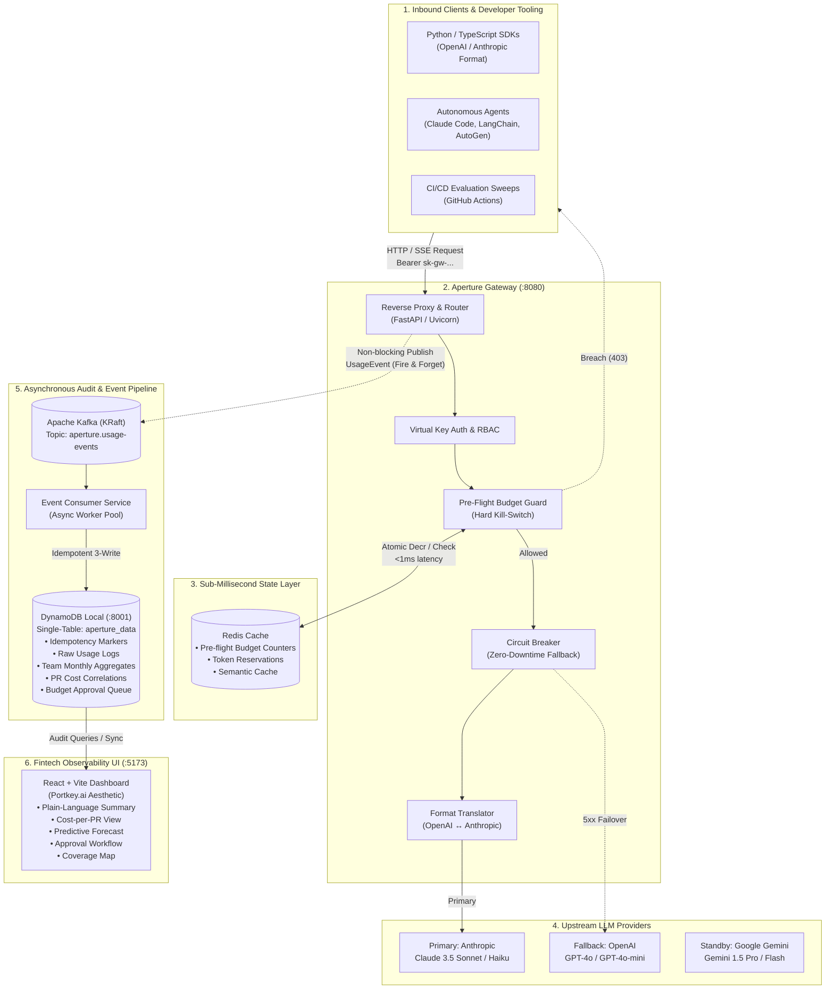
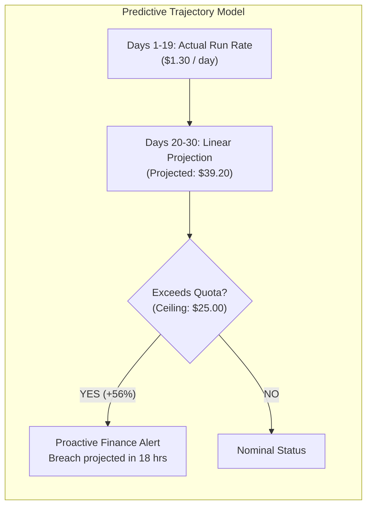
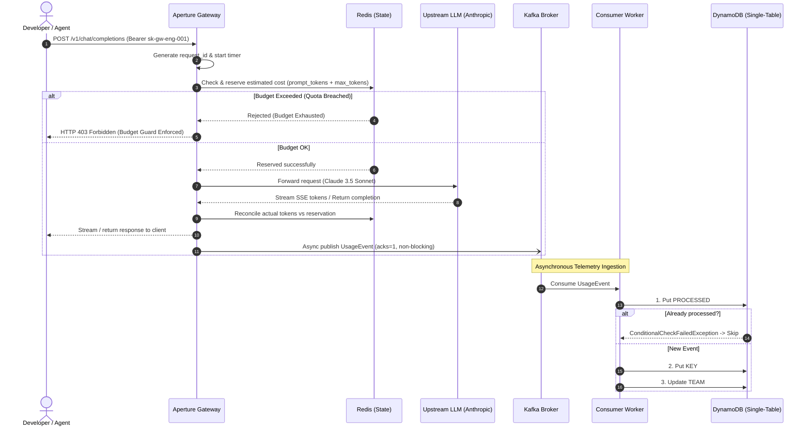
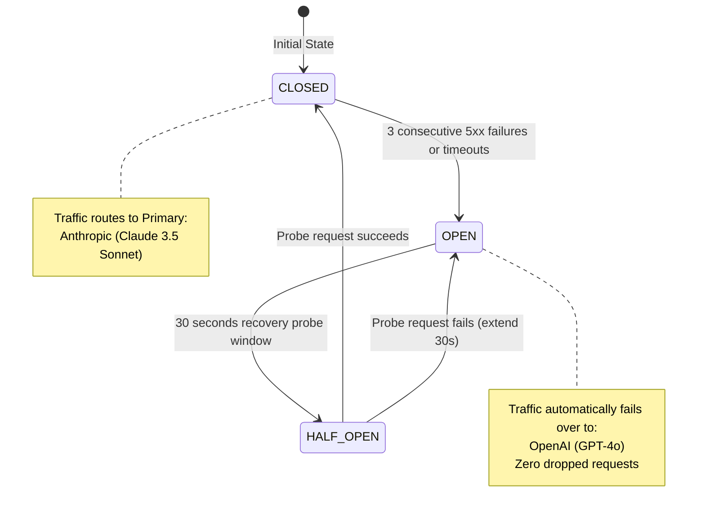
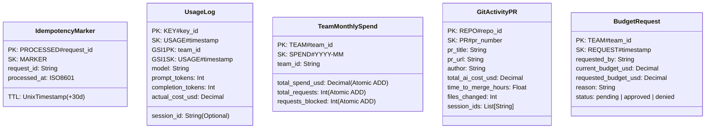

# Aperture — Enterprise AI Gateway & Fintech Spend Management Platform

[](https://python.org)
[](https://fastapi.tiangolo.com)
[](https://react.dev)
[](https://kafka.apache.org)
[](https://aws.amazon.com/dynamodb/)
[](https://redis.io)
[](https://docker.com)

**Aperture** is an enterprise-grade, OpenAI-compatible AI gateway and financial governance platform. It bridges the gap between infrastructure engineering and finance leadership by pairing **sub-millisecond pre-flight budget kill-switches** and **automated multi-provider failover** with **plain-language executive spend narratives**, **cost-per-pull-request attribution**, and **predictive month-end overage forecasting**.

---

## Table of Contents

1. [Executive Summary & Why Aperture](#executive-summary--why-aperture)
2. [End-to-End System Architecture](#end-to-end-system-architecture)
3. [Core Capabilities & Fintech Experience](#core-capabilities--fintech-experience)
4. [Request Lifecycle & Data Flow](#request-lifecycle--data-flow)
5. [Circuit Breaker & Zero-Downtime Failover](#circuit-breaker--zero-downtime-failover)
6. [Single-Table DynamoDB Schema Architecture](#singletable-dynamodb-schema-architecture)
7. [API Specification](#api-specification)
8. [Dashboard & User Interface](#dashboard--user-interface)
9. [Quick Start & Local Deployment](#quick-start--local-deployment)
10. [Verification & Testing](#verification--testing)
11. [Telemetry Coverage & Transparency Policy](#telemetry-coverage--transparency-policy)
12. [Project Directory Layout](#project-directory-layout)
13. [Design Principles & Limitations](#design-principles--limitations)

---

## Executive Summary & Why Aperture

Traditional API proxies act as passive billing meters: they record spending *after* expensive model tokens have already run. When autonomous coding agents, recursive RAG workflows, or runaway evaluation scripts trigger thousands of concurrent loops, companies wake up to surprise five-figure cloud bills.

**Aperture solves this with pre-flight financial governance:**
- **Atomic Pre-Flight Reservations:** Checks and reserves estimated token budgets in Redis *before* routing to upstream LLMs. If an allocation is exceeded, it returns HTTP 403 instantly—saving 100% of the token cost.
- **Fintech-First Communication:** Translates raw JSON telemetry into conversational, non-technical financial narratives for non-technical leadership and CFOs.
- **Cost-per-Outcome Attribution:** Links developer sessions and model tokens directly to GitHub pull requests and merged features.
- **Predictive Trajectory Forecasting:** Proactively alerts teams days before a budget breach occurs.
- **Zero-Downtime Failover:** Automatically reroutes traffic from Anthropic to OpenAI upon detecting consecutive upstream 5xx errors or rate limits.

---

## End-to-End System Architecture



---

## Core Capabilities & Fintech Experience

### 1. Plain-Language Executive Spend Narratives
Instead of burying finance leaders in raw tables of tokens and prompt counts, Aperture provides an executive narrative engine that generates conversational summaries:

> **"Engineering spent $8.40 this month (8% of $100 quota), with 66% on Claude 3.5 Sonnet, up 14% from last period at a stable run rate of $0.44/day."**

### 2. Predictive Month-End Overage Forecasting
Aperture calculates consumption velocity and projects 30-day spend trajectories. If a department is on track to breach its quota, a proactive finance alert is triggered days ahead of time:



### 3. Cost-per-Outcome (GitHub PR Attribution)
Aperture correlates gateway `UsageEvent` sessions (`session_id`), branch activity, and developer timestamps directly to GitHub Pull Requests. Engineering managers can inspect:
- Total AI spend invested in each merged PR
- Time-to-merge vs. AI spend efficiency
- Direct links to GitHub commits and PR discussions
- Clear attribution methodology disclosure

### 4. Interactive Budget Increase & Approval Loop
Teams don't have to send ad-hoc Slack messages to get more budget:
1. Developers click **Request Budget Increase** in the UI, inputting the requested quota and a mandatory business justification reason.
2. The request enters an **Admin Approval Queue**.
3. Approving the request immediately writes the new quota to DynamoDB and Redis with zero downtime.

---

## Request Lifecycle & Data Flow



---

## Circuit Breaker & Zero-Downtime Failover

Aperture implements an automated 3-state circuit breaker pattern protecting against upstream provider outages, rate limits (HTTP 429), and internal server errors (HTTP 5xx):



### Circuit Breaker Specifications
| Parameter | Default Value | Description |
| :--- | :--- | :--- |
| **Primary Provider** | `Anthropic` (`claude-3-5-sonnet`) | Default upstream target |
| **Fallback Provider** | `OpenAI` (`gpt-4o`) | Automated failover target |
| **Trip Threshold** | `3 consecutive failures` | Trips circuit upon three 5xx/timeout errors |
| **Recovery Window** | `30 seconds` | Time spent in `OPEN` before testing `HALF-OPEN` |
| **Probe Behavior** | `1 canary request` | Single test request through primary |

---

## Single-Table DynamoDB Schema Architecture

Aperture uses an overloaded **single DynamoDB table (`aperture_data`)** designed for high throughput, zero write contention, and atomic decimal aggregation.

### Key Index Overview
- **Partition Key (`PK`)**: String
- **Sort Key (`SK`)**: String
- **Global Secondary Index (`GSI1`)**: `GSI1PK` (Team ID) / `GSI1SK` (Sort Key)

### Entity Mapping & Access Patterns



### Full Entity Reference Table

| Entity Type | Partition Key (`PK`) | Sort Key (`SK`) | GSI1 (`GSI1PK` / `GSI1SK`) | Primary Attributes |
| :--- | :--- | :--- | :--- | :--- |
| **Virtual Key** | `KEY#<key_id>` | `METADATA` | `<team_id>` / `METADATA` | `name`, `role`, `budget_limit`, `is_active` |
| **Usage Log** | `KEY#<key_id>` | `USAGE#<iso_ts>` | `<team_id>` / `USAGE#<iso_ts>` | `model`, `prompt_tokens`, `cost_usd`, `session_id` |
| **Team Spend** | `TEAM#<team_id>` | `SPEND#<YYYY-MM>` | — | `total_spend_usd`, `total_requests`, `blocked` |
| **Git PR Activity** | `REPO#<repo_id>` | `PR#<number>` | — | `pr_title`, `pr_url`, `author`, `total_ai_cost` |
| **Budget Request** | `TEAM#<team_id>` | `REQUEST#<iso_ts>` | — | `requested_budget`, `reason`, `status`, `reviewer` |
| **Idempotency** | `PROCESSED#<req_id>`| `MARKER` | — | `TTL` (30 days auto-expire) |

---

## API Specification

### Inbound Gateway Endpoints
```http
POST /v1/chat/completions
Authorization: Bearer sk-gw-eng-001
Content-Type: application/json

{
  "model": "claude-3-5-sonnet",
  "messages": [{"role": "user", "content": "Analyze quarterly OPEX variance."}],
  "temperature": 0.2,
  "stream": false
}
```

### Analytics, Governance & Fintech Endpoints
| Method | Endpoint | Description |
| :--- | :--- | :--- |
| `GET` | `/api/summary/{team_id}` | Plain-language executive spend narrative & drivers |
| `GET` | `/api/forecast/{team_id}` | Predictive trajectory and month-end overage modeling |
| `GET` | `/api/correlations/prs` | Pull request cost attribution rankings |
| `GET` | `/api/budgets/requests` | List pending and historical budget requests |
| `POST` | `/api/budgets/requests` | Submit a new departmental budget increase request |
| `POST` | `/api/budgets/requests/{id}/approve` | Admin approval for budget increase |
| `POST` | `/api/budgets/requests/{id}/deny` | Admin denial with explanation reason |
| `GET` | `/api/gateway/circuit` | Live circuit breaker state, failure count, and health |
| `GET` | `/health` | Gateway Liveness probe (`{"status":"ok"}`) |

---

## Dashboard & User Interface

The Aperture dashboard is modeled after the dark-canvas, obsidian aesthetic of **Portkey.ai**, featuring glassmorphism, micro-borders, and high-contrast typography.

```
┌────────────────────────────────────────────────────────────────────────────────────────┐
│  APERTURE   Workspace: Default Org ▾   ● PROD   [Search / Filters]   Soham Banerjee ▾  │
├───────────────┬────────────────────────────────────────────────────────────────────────┤
│ OBSERVABILITY │  EXECUTIVE SPEND NARRATIVE (PLAIN-LANGUAGE ENGINE)                     │
│ &bull; Overview       │  "Engineering spent $8.40 this month (8% of quota), with 66% on       │
│ &bull; Logs & Traces  │   Claude 3.5 Sonnet, up 14% from last period at $0.44/day burn rate."  │
│ &bull; Cost per PR    ├────────────────────────────────────────────────────────────────────────┤
│ &bull; Coverage Map   │  PREDICTIVE TRAJECTORY FORECAST                                        │
│               │  [████████████████░░░░░░░░░░░░] Nominal / Projected: $13.20 of $100    │
│ AI GATEWAY    ├────────────────────────────────────────────────────────────────────────┤
│ &bull; Virtual Keys   │  LIVE TOPOLOGY & FAILOVER SIMULATOR                                    │
│ &bull; Routing & CB   │  Client ──► Gateway ──► Auth & Budgets ──► Circuit Breaker ──► Claude │
│               ├────────────────────────────────────────────────────────────────────────┤
│ GOVERNANCE    │  BUDGET APPROVAL QUEUE                                                 │
│ &bull; Budgets & RBAC │  Marketing &bull; Requested: $60.00 (+$35.00) &bull; "Q4 Campaign" [Approve] [Deny]   │
└───────────────┴────────────────────────────────────────────────────────────────────────┘
```

### Views Included
1. **Analytics Overview (`/`)**: Hero plain-language summary, KPI tiles, spend/request area charts, model distribution donut, team gauges, and live request stream.
2. **Request Logs & Traces (`/logs`)**: DynamoDB telemetry stream with absolute/relative timestamps, token breakdowns (prompt vs completion), and slide-over trace drawer.
3. **Cost per Outcome (`/outcomes`)**: PR-level AI cost attribution, GitHub URLs, author avatars, and attribution transparency notices.
4. **Virtual Keys (`/keys`)**: Masked key secrets (`pk-live-••••••••b4f2`), inline copy/reveal toggles, provider tags, and creation modal.
5. **Budgets & Approvals (`/budgets`)**: Department cards with warning threshold indicators, kill-switch toggles, predictive trajectory chart, and admin approval queue.
6. **AI Gateway Topology (`/gateway`)**: Visual topology diagram, upstream provider health table, and outage simulator.
7. **Coverage Map (`/coverage`)**: Transparent inventory of what Aperture sees vs. closed IDE tunnels.
8. **Configuration (`/config`)**: Runtime routing, Kafka broker, and DynamoDB single-table settings with interactive connection pings.

---

## Quick Start & Local Deployment

### Prerequisites
- [Docker](https://docs.docker.com/get-docker/) & Docker Compose
- Node.js 18+ & npm (for dashboard development)
- Python 3.11+ (for local testing)

### 1. Clone & Configure Environment
```bash
git clone https://github.com/COolAlien35/Aperture.git
cd Aperture
cp .env.example .env
```

Edit `.env` to supply your provider API keys:
```env
ANTHROPIC_API_KEY=your_anthropic_key_here
OPENAI_API_KEY=your_openai_key_here
DYNAMODB_ENDPOINT=http://dynamodb-local:8000
KAFKA_BOOTSTRAP_SERVERS=kafka:9092
REDIS_URL=redis://redis:6379/0
```

### 2. Launch All Services via Docker Compose
```bash
docker-compose up --build -d
```

### Service Map & Host Ports
| Service Name | Port | Description |
| :--- | :--- | :--- |
| **Aperture Gateway** | `8080` | FastAPI proxy, rate limiter, and circuit breaker |
| **Redis** | `6379` | Pre-flight budget cache and semantic store |
| **Kafka (KRaft)** | `9092` | Distributed streaming bus for usage events |
| **DynamoDB Local** | `8001` | Single-table persistence store (container: 8000) |
| **Kafka Consumer** | *Background* | Asynchronous worker pool writing to DynamoDB |
| **React Dashboard** | `5173` | Portkey.ai styled observability frontend |

### 3. Provision Database Tables
```bash
python scripts/init_dynamodb.py
```

### 4. Start the Frontend Dashboard
```bash
cd dashboard
npm install
npm run dev
# Open http://localhost:5173
```

---

## Verification & Testing

### Running Full Automated Test Suite
```bash
# Backend unit & integration tests
pytest tests/test_models.py test_reconciliation.py -v

# Frontend production bundle test
cd dashboard && npm run build
```

### Testing Failover with cURL
Send a request through the gateway:
```bash
curl -X POST http://localhost:8080/v1/chat/completions \
  -H "Authorization: Bearer sk-gw-eng-001" \
  -H "Content-Type: application/json" \
  -d '{
    "model": "claude-3-5-sonnet",
    "messages": [{"role": "user", "content": "Explain circuit breaker patterns in 10 words."}]
  }'
```

### Testing Streaming SSE Passthrough
```bash
curl -N -X POST http://localhost:8080/v1/chat/completions \
  -H "Authorization: Bearer sk-gw-eng-001" \
  -H "Content-Type: application/json" \
  -d '{
    "model": "claude-3-5-sonnet",
    "messages": [{"role": "user", "content": "Count from 1 to 5"}],
    "stream": true
  }'
```

---

## Telemetry Coverage & Transparency Policy

Enterprise buyers trust software that is candid about data boundaries. Aperture publishes its exact telemetry scope:

| Category | Coverage Level | Technical Explanation |
| :--- | :---: | :--- |
| **Claude Code CLI** | 🟢 **100% Intercepted** | Routed via `ANTHROPIC_BASE_URL`. Captures sessions & enforces limits. |
| **OpenAI / Anthropic SDKs** | 🟢 **100% Intercepted** | Intercepted by setting `baseURL` to gateway `:8080/v1`. |
| **Custom Internal AI Apps** | 🟢 **100% Intercepted** | Routed with scoped virtual keys and budget enforcement. |
| **CI/CD Eval Pipelines** | 🟢 **100% Intercepted** | Ephemeral keys and automated spend caps per run. |
| **Cursor / Windsurf Native Agents**| 🟡 **Selective** | Background codebase indexing utilizes hardcoded proprietary gRPC tunnels bypassing proxy env vars. Chat completions with custom keys are captured. *(Phase 3 eBPF daemon will intercept at socket layer)*. |
| **Consumer Web Interfaces** | 🔴 **Outside Scope** | Prompts on `chatgpt.com` or `claude.ai` bypass enterprise APIs. Intentionally omitted to protect user privacy. |

---

## Project Directory Layout

```
Aperture/
├── gateway/                    # FastAPI AI Gateway Core (Person A & B)
│   ├── main.py                 # App entrypoint, middleware pipeline
│   ├── config.py               # Environment configuration
│   ├── middleware/             # Request lifecycle middleware
│   │   ├── auth.py             # Virtual key authentication & RBAC
│   │   └── budget.py           # Pre-flight budget check & Redis reservation
│   ├── routing/                # Upstream dispatching & fallback
│   │   ├── translator.py       # OpenAI <-> Anthropic format translator
│   │   ├── streaming.py        # SSE chunk streaming & token reconciliation
│   │   └── circuit_breaker.py  # 3-state provider failover engine
│   ├── events/                 # Kafka streaming
│   │   └── producer.py         # Asynchronous fire-and-forget event publisher
│   └── models/                 # Pydantic data schemas
│       └── __init__.py         # UsageEvent, ChatCompletion, VirtualKey models
├── consumer/                   # Kafka Telemetry Consumer Worker (Person C)
│   ├── Dockerfile              # Container image definition
│   ├── handler.py              # Idempotent 3-write DynamoDB handler
│   └── main.py                 # Async consumer event loop & shutdown
├── dashboard/                  # React + Vite Frontend Dashboard (Person C)
│   ├── src/
│   │   ├── App.jsx             # Main router & layout shell
│   │   ├── index.css           # Portkey.ai design system & tokens
│   │   ├── components/         # Modular UI components
│   │   │   ├── Header.jsx      # Workspace switcher & status pills
│   │   │   ├── Sidebar.jsx     # Grouped navigation bar
│   │   │   ├── MetricCard.jsx  # KPI telemetry card
│   │   │   ├── PlainLanguageSummary.jsx  # Fintech sentence generator (Task 1)
│   │   │   ├── BudgetApprovalQueue.jsx   # Request/approval panel (Task 2)
│   │   │   ├── PredictiveForecastChart.jsx # Month-end trajectory (Task 4)
│   │   │   └── SlideDrawer.jsx # Trace inspector
│   │   └── views/              # Page views
│   │       ├── OverviewView.jsx       # Executive analytics overview
│   │       ├── LogsView.jsx           # Request traces & audit log
│   │       ├── KeysView.jsx           # Virtual keys management
│   │       ├── BudgetsView.jsx        # Spend guardrails & approval loop
│   │       ├── GatewayView.jsx        # Routing topology & circuit breaker
│   │       ├── CostPerOutcomeView.jsx # PR cost attribution (Task 3)
│   │       ├── CoverageView.jsx       # Transparency coverage map (Task 5)
│   │       ├── ConfigView.jsx         # Gateway & database configuration
│   │       └── LoginView.jsx          # Portkey split-screen authentication
├── docs/                       # Technical Specifications & Architecture
│   ├── schema.md               # Unified DynamoDB Single-Table Specification
│   ├── open_design_decisions.md# Architectural decisions & consensus log
│   └── PRD_ Enterprise AI Gateway.md # Product requirements
├── scripts/                    # Maintenance & seed utilities
│   ├── init_dynamodb.py        # Table provisioning & test seeding
│   └── test_schema_comprehensive.py # DynamoDB access pattern verification
├── docker-compose.yml          # Container orchestration (Redis, Kafka, Dynamo, Gateway)
├── Dockerfile                  # Gateway container build
└── requirements.txt            # Python dependencies
```

---

## Design Principles & Limitations

1. **At-Least-Once Kafka Delivery with Conditional Deduplication:** Kafka guarantees delivery, meaning duplicate events can arrive during network rebalances. The consumer writes `PROCESSED#<request_id>` with an `attribute_not_exists(PK)` condition before updating aggregates, preventing double-billing.
2. **Fixed-Calendar Budget Boundaries:** Monthly quotas reset at midnight UTC on the 1st of each month for predictability with corporate accounting cycles.
3. **Cache TTL & Revocation Window:** Virtual key metadata is cached in Redis with a 60-second TTL to keep hot-path latency `<2ms`.
4. **Streaming Disconnect Policy:** Incomplete or aborted SSE streams reconcile actual emitted tokens against pre-reserved estimates upon socket termination.

---

## License

Apache License 2.0. See [LICENSE](LICENSE) for details.
